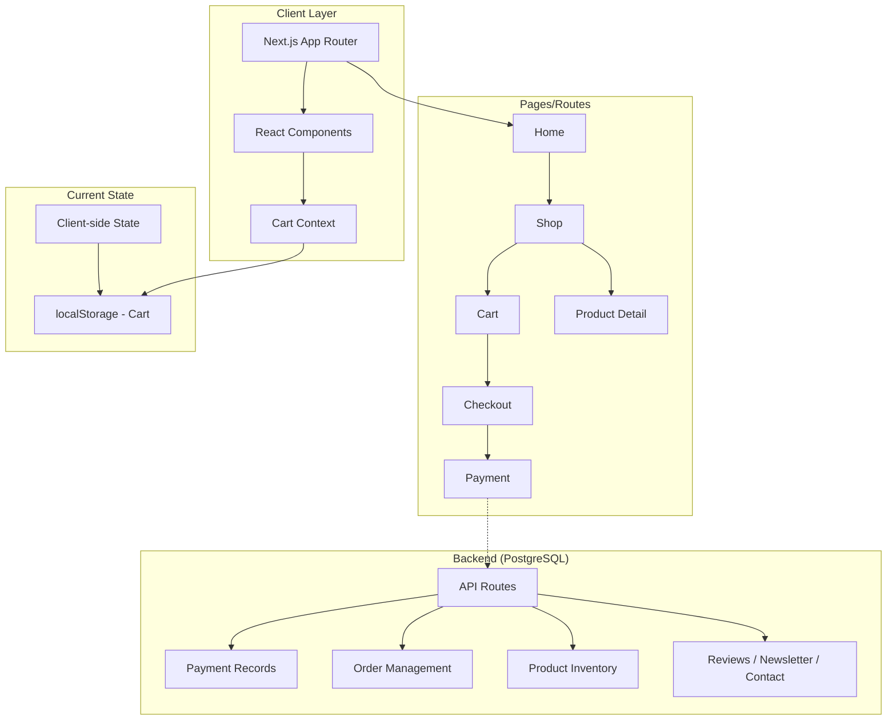
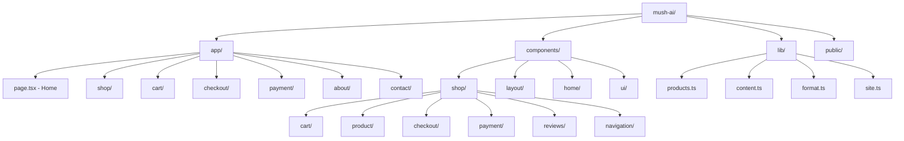

# SmartMushroom Web Platform

SmartMushroom is a Next.js 16 web application for JKUAT's SmartMushroom initiative - revolutionizing indoor mushroom agriculture with pumice-based structures, IoT monitoring, and AI-driven climate control. The platform enables farmers to purchase grow kits, spawn, and access training services while supporting a closed-loop value chain.

## Table of Contents

- [Project Overview](#project-overview)
- [Tech Stack](#tech-stack)
- [Architecture](#architecture)
- [Backend API](#backend-api)
- [Getting Started](#getting-started)
- [Project Structure](#project-structure)

## Project Overview

SmartMushroom addresses the challenges of traditional mushroom farming (high energy costs, strict climate requirements, 95% failure rate) through:

- **Pumice Structures**: Passive cooling reducing energy dependency
- **IoT Monitoring**: Real-time temperature, humidity, and CO₂ tracking
- **JKUAT Strains**: Proprietary JAMBO101 and MAMBO101 oyster mushroom strains
- **Closed-Loop System**: Spent substrate returned as organic fertilizer
- **Value-Add Products**: Dried mushrooms, mushroom crisp, and Myco-Vino mushroom wine

## Tech Stack

| Technology                                    | Version | Purpose                         |
| --------------------------------------------- | ------- | ------------------------------- |
| [Next.js](https://nextjs.org/)                | 16.4.2  | React framework with App Router |
| [React](https://react.dev/)                   | 19.3.0  | UI library                      |
| [TypeScript](https://www.typescriptlang.org/) | ^5      | Type safety                     |
| [Tailwind CSS](https://tailwindcss.com/)      | ^4.3.3  | Styling                         |
| [Framer Motion](https://motion.dev/)          | ^14.6.0 | Animations                      |
| [Lucide React](https://lucide.dev/)           | ^1.55.0 | Icons                           |
| [Bun](https://bun.sh/)                        | 1.4.2   | Package manager/runtime         |
| [PostgreSQL](https://www.postgresql.org/)    | 18      | Primary database (`pg`)         |

## Architecture



## Backend API

All data is persisted to PostgreSQL. Route handlers live under `app/api/` and
share a connection pool plus helpers in `lib/`.

| Method | Route                                | Purpose                                          |
| ------ | ------------------------------------ | ------------------------------------------------ |
| `POST` | `/api/newsletter`                    | Subscribe an email (idempotent)                  |
| `POST` | `/api/contact`                       | Store a contact-form message                     |
| `GET`  | `/api/products`                      | Catalogue, optional `?category=` filter          |
| `GET`  | `/api/products/[productId]`          | Single product                                   |
| `GET`  | `/api/products/[productId]/reviews`  | Reviews for a product, newest first              |
| `POST` | `/api/products/[productId]/reviews`  | Submit a review                                  |
| `POST` | `/api/orders`                        | Create an order (prices read server-side)        |
| `GET`  | `/api/orders?id=`                    | Look up an order                                 |
| `POST` | `/api/payments`                      | Record a payment and mark the order `paid`       |
| `GET`  | `/api/payments?id=`                  | Look up a payment                                |

Order prices are always computed from the `products` table inside a
transaction, so a tampered client payload cannot change what is charged.
Payment gateways (Safaricom Daraja, Paystack/Flutterwave) are not wired up yet;
`POST /api/payments` records payments in simulation mode and the order flips to
`paid`. Swap the simulation block for a real gateway call when credentials are
available.

### Database setup

```bash
# 1. Point at your Postgres instance
cp .env.example .env.local   # then edit DATABASE_URL

# 2. Create the schema, then seed from lib/products.ts
bun run db:migrate
bun run db:seed
```

Tables created: `users`, `newsletter_subscribers`, `contact_messages`,
`products`, `reviews`, `orders`, `order_items`, `payments`.

| File                | Purpose                                             |
| ------------------- | --------------------------------------------------- |
| `lib/db/schema.sql` | Schema, constraints and triggers                    |
| `lib/db/index.ts`   | Shared `Pool`, `query`, `queryOne`, `withTransaction`|
| `lib/db/mappers.ts` | Postgres rows → frontend `Product` / `ReviewItem`    |
| `lib/api.ts`        | JSON helpers, validation, `ApiError`                |

## Getting Started

### Prerequisites

- [Bun](https://bun.sh/) v1.4.2 or higher
- Node.js 18+ (if not using Bun)

### Installation

```bash
# Clone the repository
git clone <repository-url>
cd mush-ai

# Install dependencies
bun install

# Run development server
bun dev
```

Open [http://localhost:3000](http://localhost:3000) to view the application.

### Build

```bash
bun run build
bun start
```

## Project Structure



### Directory Breakdown

| Directory            | Purpose                                                               |
| -------------------- | --------------------------------------------------------------------- |
| `app/`               | Next.js App Router pages and layouts                                  |
| `components/shop/`   | All e-commerce related components (cart, checkout, payment, products) |
| `components/layout/` | Header, Footer, navigation                                            |
| `components/home/`   | Homepage sections                                                     |
| `lib/`               | Utilities, product data, content                                      |
| `public/images/`     | Static assets organized by section                                    |
